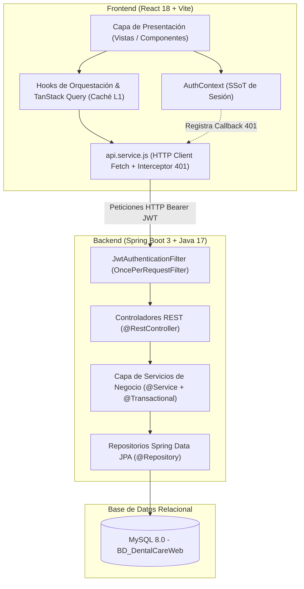
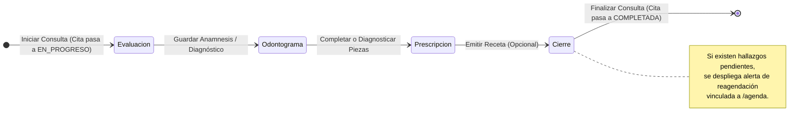
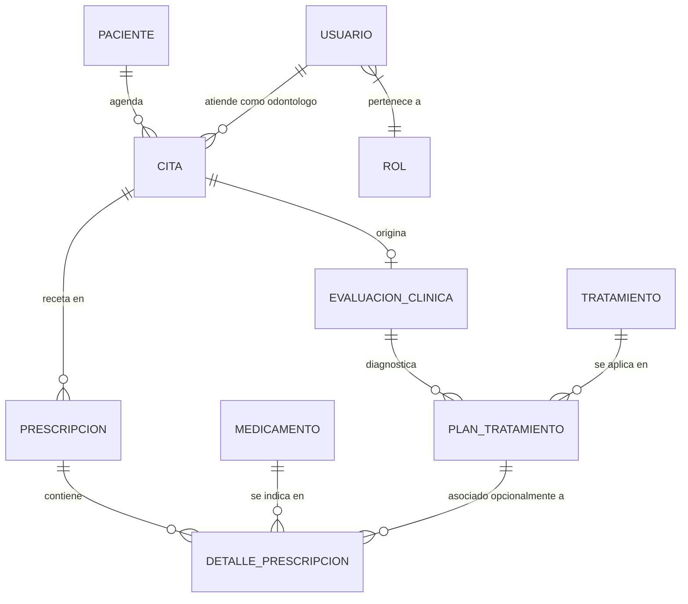

# MANUAL DE ARQUITECTURA Y BLUEPRINT DEL SISTEMA DENTALCARE ERP
> **Documento Maestro de Arquitectura, Flujos de Negocio y Registro de Cambios**  
> **Destinatarios:** Ingenieros de Software, Arquitectos de Soluciones y Asistentes de IA Autónomos.  
> **Objetivo:** Permitir a cualquier modelo de IA o desarrollador comprender en su totalidad la estructura, contratos, dependencias y reglas del sistema para realizar extensiones o depuraciones sin necesidad de inspeccionar línea por línea el código fuente.

---

## 📑 ÍNDICE GENERAL

1. [Registro Histórico y Consolidado de Cambios](#1-registro-histórico-y-consolidado-de-cambios)
   - 1.1 Correcciones Clínicas y de Persistencia en Base de Datos
   - 1.2 Transición Visual y Sistema de Diseño (Design System)
   - 1.3 Endurecimiento Arquitectónico y Manejo de Sesión (SSoT)
2. [Topología y Arquitectura General del Sistema](#2-topología-y-arquitectura-general-del-sistema)
   - 2.1 Diagrama de Interacción End-to-End
   - 2.2 Diccionario Global de Enumeraciones y Estados Compartidos
3. [Blueprint de Arquitectura Frontend](#3-blueprint-de-arquitectura-frontend)
   - 3.1 Estructura por Capas y Árbol de Responsabilidades
   - 3.2 Matriz de Enrutamiento y Control de Acceso (RBAC)
   - 3.3 Motor del Flujo Clínico (Stepper de 4 Etapas)
   - 3.4 Modelo de Estado: Servidor (TanStack Query) vs. Formulario (RHF)
4. [Blueprint de Arquitectura Backend](#4-blueprint-de-arquitectura-backend)
   - 4.1 Capas de Dominio y Flujo de Peticiones
   - 4.2 Modelo Relacional de Base de Datos e Invariantes de Integridad
   - 4.3 Pipeline de Seguridad Stateless JWT
   - 4.4 Catálogo de Endpoints y Contratos de Servicio
5. [Protocolo de Extensión y Modificación para Modelos de IA](#5-protocolo-de-extensión-y-modificación-para-modelos-de-ia)
   - 5.1 Receta: Agregar o Modificar un Paso Clínico
   - 5.2 Receta: Extender un Endpoint o Entidad de Persistencia
   - 5.3 Invariantes Críticos que Nunca Deben Romperse

---

## 1. REGISTRO HISTÓRICO Y CONSOLIDADO DE CAMBIOS

En el marco del ciclo de refactorización y solución de incidentes reportados, se aplicaron las siguientes modificaciones estratégicas:

### 1.1 Correcciones Clínicas y de Persistencia en Base de Datos

* **Anulabilidad de `pieza_dental` en Hallazgos Clínicos:**
  - *Problema original:* En tratamientos generales o de boca completa (ej. Profilaxis, Gingivectomía General, Evaluación Periodontal), la columna `pieza_dental` en MySQL poseía restricción `NOT NULL`, provocando caídas `SQL Error: 1048` al intentar registrar planes sin un diente específico.
  - *Solución:* Modificación del DDL en MySQL permitiendo `pieza_dental NULL`, actualización de `@Column(nullable = true)` en `PlanTratamiento.java`, y generación de un ejecutable defensivo de migración de esquema (`DatabaseSchemaMigrationRunner.java`).
* **Asociación de Entidad Foránea en `id_tratamiento`:**
  - *Problema original:* Al persistir un nuevo `PlanTratamiento`, el servicio mapeaba los atributos primitivos pero omitía enlazar la instancia resuelta de `Tratamiento`, provocando `Column 'id_tratamiento' cannot be null`.
  - *Solución:* Inclusión estricta de `plan.setTratamiento(tratamiento)` en `ConsultaService.java`.
* **Reutilización y Agregación de Prescripciones Médicas:**
  - *Problema original:* El sistema bloqueaba la adición de recetas complementarias mostrando el error "Ya existe una receta vinculada", impidiendo añadir medicamentos a procedimientos clínicos recién completados.
  - *Solución:* Refactorización de `crearPrescripcion()` en `ConsultaService.java`. Si ya existe una receta para la cita, reutiliza la cabecera existente y anexa los nuevos ítems mediante `detalleRepository.saveAll()`. Adicionalmente, se vincula formalmente el `idPlanTratamiento` en cada renglón farmacéutico.
* **Compatibilidad de Estados de Cita (`COMPLETADA` vs. `FINALIZADA`):**
  - *Problema original:* La tabla MySQL `cita` posee una columna ENUM con valores estrictos (`PROGRAMADA`, `PENDIENTE`, `EN_PROGRESO`, `COMPLETADA`, `REPROGRAMADA`, `CANCELADA`, `NO_ASISTIO`, `OTRO`). Al enviar `FINALIZADA`, MySQL arrojaba `Data truncated for column 'estado_cita'`.
  - *Solución:* Inclusión de `COMPLETADA` en el enum `EstadoCita.java` de Spring Boot, mapeo bidireccional en controladores y envío de `COMPLETADA` desde el cliente HTTP.
* **Integridad Referencial en Eliminación de Pacientes:**
  - *Problema original:* Intentar eliminar un paciente con citas registradas lanzaba una excepción 500 no controlada por Foreign Key.
  - *Solución:* Validación previa con `existsByPaciente_IdPaciente` en `PacienteService.java` que retorna HTTP 400 semántico antes de ejecutar el borrado físico.
* **Reagendación Automática en Cierre Clínico:**
  - *Problema original:* Si un paciente finalizaba la sesión pero quedaban hallazgos patológicos pendientes, la cita simplemente se cerraba sin planificar el seguimiento.
  - *Solución:* Inclusión de un banner de alerta clínica en `StepCierre.jsx` con botón directo "Agendar Próxima Cita Ahora", redirigiendo a `/agenda` con parámetros contextuales (`?pacienteId=X&nuevaCita=true`).

### 1.2 Transición Visual y Sistema de Diseño (Design System)

* **Fundación Tipográfica y Cromática (Commit 0):**
  - Importación institucional de Google Fonts: *Plus Jakarta Sans* (cuerpo de texto, alta legibilidad) y *Outfit* (encabezados, carácter geométrico moderno).
  - Configuración de tokens en `tailwind.config.js`:
    - `primary`: Gama de azul clínico (50 a 900) para confianza y tecnología.
    - `dental`: Gama de teal / menta (50 a 800) para salud dental e higiene.
    - `surface`: Tonos neutros cálidos (`#f8fafc`, bordes `#e2e8f0`).
* **Kit Atómico de Componentes de Interfaz (`src/components/ui/`):**
  - Modernización visual de `Button.jsx` con variantes semánticas, micro-escalas al presionar (`active:scale-[0.98]`) y anillos de foco accesibles.
  - `AvatarBadge.jsx` con degradados cromáticos deterministas basados en código hash de iniciales y anillo protector blanco.
  - `StatusBadge.jsx` con indicador puntual dinámico (`dot`) y animación de pulso (`animate-pulse`) en estados de atención activa.
  - Nuevas primitivas con `forwardRef`: `Input.jsx`, `Select.jsx` y `Textarea.jsx`, con soporte integrado de etiquetas accesibles, iconos y bordes de validación de error en rojo.
* **Estructura Envolvente (`Layout.jsx`) y Dashboard Ejecutivo:**
  - Encabezado con insignia institucional "ERP Clínico", fecha localizada en español salvadoreño y menú desplegable de usuario con degradados.
  - Barra lateral estilizada con tooltips flotantes a la derecha y resaltado activo.
  - Dashboard con tarjeta de bienvenida en gradiente médico, accesos directos temáticos y tarjetas estadísticas con íconos vectoriales.
* **Ajuste del Odontograma FDI:**
  - Inyección de variables CSS nativas (`--dark-blue`, `--base-blue`, `--light-blue`) en `odontograma.css` y control de altura responsiva mínima para evitar colapso en contenedores Flexbox.

### 1.3 Endurecimiento Arquitectónico y Manejo de Sesión (SSoT)

* **Fuente Única de Verdad de Sesión (`AuthContext.jsx`):**
  - Centralización del estado de autenticación en React eliminando lecturas dispersas directas a `localStorage`.
  - Detección de sesión cruzada entre pestañas mediante el evento nativo `window.addEventListener('storage')`.
  - Desacoplamiento del cierre de sesión ante respuestas HTTP 401 mediante el patrón callback (`setUnauthorizedHandler` en `api.service.js`).
* **Límite de Captura de Excepciones Visuales (`ErrorBoundary.jsx`):**
  - Aislamiento de caídas catastróficas en el ciclo de renderizado de React para evitar la "pantalla blanca", ofreciendo una vista institucional de rescate con opciones de reintento.

---

## 2. TOPOLOGÍA Y ARQUITECTURA GENERAL DEL SISTEMA



### 2.2 Diccionario Global de Enumeraciones y Estados Compartidos

| Entidad | Clave de Enumeración | Valores Válidos | Significado Clínico / Operativo |
| :--- | :--- | :--- | :--- |
| **Cita** | `EstadoCita` | `PROGRAMADA` | Cita agendada; paciente aún no se presenta en recepción. |
| | | `PENDIENTE` | Paciente realizó Check-in en sala de espera; listo para consulta. |
| | | `EN_PROGRESO` | Paciente se encuentra en sillón dental con el odontólogo. |
| | | `COMPLETADA` | Consulta médica concluida y cerrada en el sistema. |
| | | `REPROGRAMADA`| Cita movida a otra fecha/horario; historial preservado. |
| | | `CANCELADA`   | Cita anulada con motivo obligatorio justificado. |
| | | `NO_ASISTIO`  | Paciente no se presentó en la jornada indicada. |
| **Hallazgo / Plan** | `EstadoPlan` | `PENDIENTE` | Patología diagnosticada en odontograma, pendiente de planificar. |
| | | `PROGRAMADO` | Tratamiento agendado para su ejecución. |
| | | `EN_PROGRESO`| Procedimiento iniciado en múltiples fases. |
| | | `COMPLETADO` | Procedimiento odontológico finalizado con éxito. |
| | | `CANCELADO`  | Tratamiento descartado o sustituido. |
| **Rol Usuario** | `NombreRol` | `ADMIN` | Acceso irrestricto (Usuarios, Accesos, Catálogos, Citas). |
| | | `GERENTE`    | Auditoría de operaciones, reportes y configuración. |
| | | `RECEPCIONISTA`| Agenda, citas, check-in, expedientes de pacientes. |
| | | `ODONTOLOGO` | Consultas clínicas, diagnóstico odontograma y prescripción. |

---

## 3. BLUEPRINT DE ARQUITECTURA FRONTEND

### 3.1 Estructura por Capas y Árbol de Responsabilidades

```text
src/
├── components/          # Componentes de dominio y composición
│   ├── ui/              # Primitivas atómicas agnósticas (Button, Input, Select, Modal, Badge)
│   ├── Layout.jsx       # Shell principal (Sidebar colapsable + Header institucional)
│   ├── ProtectedRoute   # Guard de autenticación y autorización por RBAC
│   ├── ConsultaBanner   # Cabecera de consulta activa + Stepper de 4 fases
│   ├── StepEvaluacion   # Fase 1: Anamnesis y motivo de consulta
│   ├── StepOdontograma  # Fase 2: Odontograma interactivo FDI + Catálogo de hallazgos
│   ├── StepPrescripcion # Fase 3: Emisión de recetas farmacológicas
│   └── StepCierre       # Fase 4: Resumen, facturación clínica y reagendación
├── context/             # Proveedores de estado transversal (AuthContext SSoT)
├── hooks/               # Orquestadores de lógica de negocio y queries remotas
│   ├── useHomeDashboard # Métricas del día y agenda inmediata
│   ├── useAgenda        # CRUD de citas, mini-calendario, check-in
│   ├── useConsultaData  # Estado de la consulta activa y evaluación médica
│   ├── useTratamientos  # Odontograma, selección de piezas y hallazgos
│   └── usePrescripcion  # Catálogo farmacológico y emisión de recetas
├── services/            # Clientes de consumo HTTP (Fetch API desacoplada)
├── utils/               # Funciones puras (fechas, monedas, normalización)
└── views/               # Páginas completas asociadas al enrutador
```

### 3.2 Matriz de Enrutamiento y Control de Acceso (RBAC)

| Ruta Visual | Vista Componente | Roles Autorizados | Propósito Funcional |
| :--- | :--- | :--- | :--- |
| `/` o `/login` | `LoginPage.jsx` | Público | Autenticación de credenciales y generación de sesión. |
| `/dashboard` | `DashboardPage.jsx`| Todos (`ADMIN`, `GERENTE`, `RECEPCIONISTA`, `ODONTOLOGO`) | Panel de control, estadísticas del día y accesos directos. |
| `/agenda` | `AppointmentPage.jsx` | `ADMIN`, `RECEPCIONISTA`, `GERENTE` | Gestión de agenda médica, calendario, citas y check-in. |
| `/pacientes` | `PatientManagementPage.jsx` | `ADMIN`, `RECEPCIONISTA`, `GERENTE` | Directorio y expedientes generales de pacientes. |
| `/consulta` | `ConsultaIndexPage.jsx` | `ADMIN`, `ODONTOLOGO` | Sala de espera clínica y selección de paciente a atender. |
| `/consulta/:citaId` | `ActiveConsultationPage.jsx` | `ADMIN`, `ODONTOLOGO` | Protocolo de consulta interactiva paso a paso. |
| `/usuarios` | `UserManagementPage.jsx` | `ADMIN` | Administración de personal, credenciales y roles. |
| `/revisar-accesos` | `AccessReviewPage.jsx` | `ADMIN` | Auditoría de accesos e inicios de sesión. |

### 3.3 Motor del Flujo Clínico (Stepper de 4 Etapas)



1. **Etapa 1 (`StepEvaluacion.jsx`):** Captura motivo de consulta, presión arterial, temperatura, peso y observaciones diagnósticas. Persiste en `evaluacion_clinica`.
2. **Etapa 2 (`StepOdontograma.jsx`):** Renderiza el odontograma FDI. Permite marcar piezas o seleccionar procedimientos generales. Persiste en `plan_tratamiento` vinculando `id_evaluacion_clinica` e `id_tratamiento`.
3. **Etapa 3 (`StepPrescripcion.jsx`):** Permite recetar medicamentos vinculados a procedimientos realizados (`COMPLETADO`). Persiste en `prescripcion` y `detalle_prescripcion`.
4. **Etapa 4 (`StepCierre.jsx`):** Balance económico, verificación de procedimientos pendientes, cierre a estado `COMPLETADA` y enlace para agendar cita siguiente.

---

## 4. BLUEPRINT DE ARQUITECTURA BACKEND

### 4.1 Capas de Dominio y Flujo de Peticiones

El backend opera bajo una arquitectura en capas tradicional sobre Spring Boot 3:
1. **Capa de Controladores (`controllers/`):** Exponen los endpoints REST, definen los códigos HTTP de respuesta (`@ResponseStatus`), validan los DTOs de entrada mediante Bean Validation (`@Valid`) y mapean peticiones hacia la capa de servicio.
2. **Capa de Servicios (`services/`):** Encapsula la lógica de negocio pura, reglas transaccionales (`@Transactional`), control de unicidad, auditoría y orquestación de repositorios.
3. **Capa de Repositorios (`repositories/`):** Interfaces `JpaRepository` con consultas derivadas y queries nativas/JPQL para acceso eficiente a MySQL.
4. **Capa de Dominio / Entidades (`models/`):** Modelado relacional mapeado con anotaciones JPA/Hibernate y validación a nivel de entidad.

### 4.2 Modelo Relacional de Base de Datos e Invariantes de Integridad



#### Reglas e Invariantes Críticos del Modelo de Datos:
* **`Cita.estadoCita`:** Controlado por Enum en Base de Datos. Los estados válidos para inserción son `PROGRAMADA`, `PENDIENTE`, `EN_PROGRESO`, `COMPLETADA`, `CANCELADA`, `REPROGRAMADA`, `NO_ASISTIO`.
* **`PlanTratamiento.piezaDental`:** Es opcional (`NULL` permitido). Tratamientos que involucren toda la cavidad bucal o de carácter general llevan `NULL` o valor neutro `0`.
* **`PlanTratamiento.tratamiento`:** Es estrictamente obligatorio (`NOT NULL`). Todo hallazgo debe estar tipificado en el catálogo `tratamiento`.
* **`Prescripcion`:** Una cita médica posee una cabecera de prescripción a la cual se le agregan múltiples líneas en `detalle_prescripcion`. Si se prescriben nuevos fármacos en la misma sesión, se deben anexar al ID de prescripción existente sin duplicar la cabecera.
* **Eliminación de `Paciente`:** Restringida si existen registros hijos en la tabla `cita` (Protección contra orfandad relacional).

### 4.3 Pipeline de Seguridad Stateless JWT

1. **Autenticación Inicial (`POST /api/auth/login`):** Recibe identificador y clave; `AutentificacionService` valida contra hash BCrypt y emite un token JWT firmado mediante clave secreta HMAC-SHA256 (`${jwt.secret}`).
2. **Filtro de Intercepción (`JwtAuthenticationFilter`):** Hereda de `OncePerRequestFilter`. Extrae cabecera `Authorization: Bearer <token>`, valida firma y expiración con `JwtUtil`, extrae el rol y establece la autenticación en `SecurityContextHolder`.
3. **Manejo de Acceso Denegado (`JwtAuthEntryPoint`):** Intercepta accesos no autorizados y emite respuesta estructurada JSON `401 Unauthorized`.
4. **Matriz de Seguridad (`SecurityConfig`):**
   - Endpoints Públicos: `/api/auth/**`, `OPTIONS /**`, `/error`.
   - Restricción Administrativa: `/api/usuarios/**` (Exclusivo `ADMIN` y `GERENTE`), `/api/registros-acceso/**` (Exclusivo `ADMIN`).
   - Resto de endpoints clínicos: Requieren autenticación con token activo.

### 4.4 Catálogo de Endpoints y Contratos de Servicio

| Módulo | Método | Endpoint | Roles Permitidos | Parámetros / Cuerpo Clave |
| :--- | :---: | :--- | :--- | :--- |
| **Auth** | `POST` | `/api/auth/login` | Público | `{ identifier, password }` |
| **Citas** | `GET` | `/api/citas` | Autenticado | Retorna listado consolidado con DTO aplanado. |
| | `POST` | `/api/citas` | `ADMIN`, `RECEPCIONISTA` | `{ idPaciente, idOdontologo, fechaCita, horaInicioCita, horaFinCita, estadoCita }` |
| | `PUT` | `/api/citas/{id}/cancelar`| Autenticado | `{ motivoCancelacion }` (Obligatorio `@NotBlank`) |
| | `PATCH`| `/api/citas/{id}/estado`| Autenticado | `?nuevoEstado=COMPLETADA` |
| **Pacientes**| `GET` | `/api/pacientes` | Autenticado | Listado de expedientes activos. |
| | `GET` | `/api/pacientes/buscar` | Autenticado | `?termino=DUI_o_Nombre` |
| | `POST`| `/api/pacientes` | `ADMIN`, `RECEPCIONISTA` | `{ nombrePaciente, apellidoPaciente, numeroIdentidadPaciente, telefono, ... }` |
| | `DELETE`| `/api/pacientes/{id}` | `ADMIN` | Valida integridad antes de eliminar. |
| **Consulta** | `POST`| `/api/consultas/evaluacion` | `ODONTOLOGO`, `ADMIN` | `{ idCita, motivoConsulta, presionArterial, temperatura, ... }` |
| | `POST`| `/api/consultas/hallazgo` | `ODONTOLOGO`, `ADMIN` | `{ idEvaluacionClinica, idTratamiento, piezaDental, costoAplicado }` |
| | `PATCH`| `/api/consultas/hallazgo/{id}/estado`| `ODONTOLOGO`, `ADMIN`| `{ estado: "COMPLETADO" }` |
| | `POST`| `/api/consultas/prescripcion`| `ODONTOLOGO`, `ADMIN`| `{ idCita, detalles: [{ idMedicamento, idPlanTratamiento, dosis, ... }] }` |

---

## 5. PROTOCOLO DE EXTENSIÓN Y MODIFICACIÓN PARA MODELOS DE IA

Cualquier modelo de IA que requiera alterar o ampliar el sistema debe seguir estrictamente estas directrices:

### 5.1 Receta: Agregar o Modificar un Paso Clínico
1. **En Frontend:**
   - Modificar la constante `STEPS` en `ConsultaBanner.jsx` para reflejar la nueva fase.
   - Crear el componente contenedor en `src/components/Step[Nuevo].jsx`.
   - Registrar la etapa en el switch-case de renderizado en `src/views/ActiveConsultationPage.jsx`.
   - Conectar las operaciones de lectura y mutación mediante un hook especializado en `src/hooks/`.
2. **En Backend (si requiere persistencia):**
   - Si se añade un concepto clínico nuevo, crear la entidad en `models/` y su DTO correspondiente en `dtos/`.
   - Crear el `JpaRepository` correspondiente.
   - Enlazar la lógica en `ConsultaService.java` exponiendo el método transaccional `@Transactional`.
   - Exponer el endpoint en `ConsultaController.java`.

### 5.2 Receta: Extender un Endpoint o Entidad de Persistencia
1. **Regla de Enumeraciones:** Si se agrega un nuevo estado en MySQL, se debe actualizar primero la definición ENUM en base de datos, luego la clase enum en Java (`com.dentalcare.api.models.enums.*`) y finalmente las constantes del frontend (`src/constants/estados.constants.js`).
2. **Regla de Fechas y Zonas Horarias:** 
   - El sistema opera en zona horaria El Salvador (UTC-6).
   - En frontend, **NUNCA** utilizar `date.toISOString().split('T')[0]` para derivar la fecha local de una cita, ya que en horarios nocturnos (después de las 6:00 PM) la conversión a UTC desplaza la fecha al día siguiente.
   - Utilizar siempre la utilidad provista `obtenerFechaLocalISO(date)` o `getHoyLocal()`.

### 5.3 Invariantes Críticos que Nunca Deben Romperse
* **No escribir llamadas directas a `localStorage` en vistas React:** Toda interacción con el token o la identidad del usuario debe canalizarse por `useAuth()` (`AuthContext.jsx`).
* **No generar dobles fuentes de verdad en formularios:** Los inputs controlados por validación deben residir en React Hook Form; los hooks de datos solo reciben el payload final validado.
* **No usar `try-catch` genéricos en controladores de Spring:** Las validaciones de Bean Validation se capturan automáticamente; los errores de negocio deben lanzar excepciones semánticas (`IllegalArgumentException`, `IllegalStateException`) manejadas por la capa transversal.
* **Preservar los identificadores únicos en consultas médicas:** Todo hallazgo (`PlanTratamiento`) requiere obligatoriamente `idEvaluacionClinica` e `idTratamiento`.
