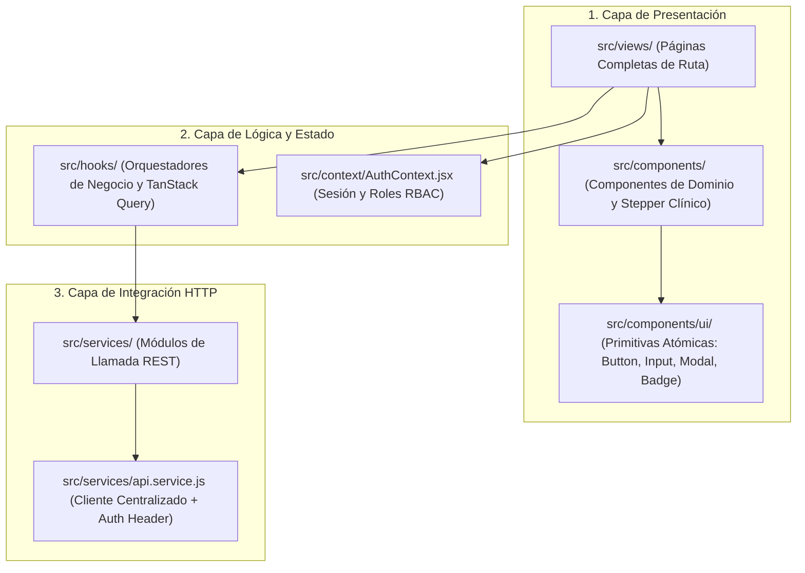
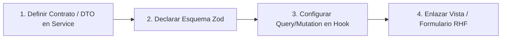

# GUÍA DE ARQUITECTURA E INTEGRACIÓN FRONTEND: DENTALCARE ERP
> **Estándar:** React 18, Vite, Tailwind CSS, TanStack Query v5, React Hook Form v7, Zod v4  
> **Directriz de Formato:** Especificación Arquitectónica Pura (sin volcados extensos de código fuente). Diseñado para que cualquier desarrollador o modelo de IA comprenda la estructura de presentación, estado de servidor y flujos clínicos sin requerir inspección exhaustiva de archivos.

---

## 🏛️ 1. DICTAMEN Y PRINCIPIOS ARQUITECTÓNICOS

### 1.1 Decisiones Arquitectónicas Aprobadas
1. **Separación Estricta de Estado:**
   - **Estado de Servidor:** Gestionado exclusivamente por TanStack Query. Prohibido duplicar colecciones del backend en `useState` locales con `useEffect` dispersos.
   - **Estado de Formularios:** Gestionado exclusivamente por React Hook Form con resolución de esquemas Zod. Se evita la Doble Fuente de Verdad (*Dual SSoT*).
   - **Estado de Sesión:** Centralizado en `AuthContext.jsx` con sincronización multi-pestaña (`storage` event) e interceptor de desconexión ante HTTP 401.
2. **Resiliencia de Render:**
   - Contención de excepciones visuales en tiempo de ejecución mediante `ErrorBoundary` institucional para evitar caídas a pantalla blanca (*White Screen of Death*).
3. **Consistencia Visual con Design System Extendido:**
   - Paleta clínica institucional (`primary`, `dental`, `surface`), tipografías (*Plus Jakarta Sans*, *Outfit*) e indicadores interactivos normalizados.

### 1.2 Antipatrones Descartados y Prohibidos
* **Prohibido:** Mutar referencias mutables (`ref.current`) durante la fase pura de renderizado (genera inconsistencias en React 18 Concurrent).
* **Prohibido:** Lecturas o escrituras directas a `localStorage` desde componentes visuales o vistas (rompe el principio de reactividad).
* **Prohibido:** Uso de `date.toISOString().split('T')[0]` para derivar la fecha local de una cita (provoca desfases de día por diferencia horaria UTC vs. UTC-6).

---

## 📦 2. HOJA DE RUTA DE COMMITS ATÓMICOS

| Commit | Tipo / Mensaje Semántico | Responsabilidad Arquitectónica | Archivos Afectados |
| :---: | :--- | :--- | :--- |
| **0** | `style(design-system)` | Tokens de color, tipografía Google Fonts, scrollbar e iconografía | `index.html`, `tailwind.config.js`, `src/index.css`, `package.json`, `src/main.jsx` |
| **1** | `chore(deps)` | Instalación de librerías base de estado y validación | `package.json`, `package-lock.json` |
| **2** | `feat(cache)` | Instancia global de `QueryClient` con directivas para entorno médico | `src/main.jsx` |
| **3** | `feat(resilience)` | Frontera de captura de excepciones visuales (`ErrorBoundary`) | `src/components/ErrorBoundary.jsx`, `src/App.jsx` |
| **4** | `feat(auth)` | SSoT reactivo de sesión, guard de rutas y callback de error 401 | `src/services/api.service.js`, `src/context/AuthContext.jsx`, `src/components/ProtectedRoute.jsx`, `src/components/Layout.jsx`, `src/views/LoginPage.jsx`, `src/App.jsx` |
| **5** | `refactor(hooks)` | Migración a TanStack Query en Dashboard y Agenda médica | `src/hooks/useHomeDashboard.js`, `src/hooks/useAgenda.js` |
| **6** | `refactor(hooks)` | Búsqueda abortable de pacientes y catálogos de usuarios en caché | `src/hooks/usePatientManagement.js`, `src/hooks/useUserManagement.js` |
| **7** | `refactor(hooks)` | Flujo clínico, evaluación diagnóstica, odontograma y prescripción | `src/hooks/useConsultaIndex.js`, `src/hooks/useConsultaData.js`, `src/hooks/useTratamientos.js`, `src/hooks/usePrescripcion.js` |
| **8** | `feat(forms)` | Esquemas Zod y cálculo automático de hora fin en Citas | `src/components/AppointmentForm.jsx`, `src/components/ReprogramModal.jsx`, `src/views/AppointmentPage.jsx` |
| **9** | `feat(forms)` | Validación declarativa de DUI, teléfono y contacto en Pacientes | `src/views/PatientManagementPage.jsx` |
| **10** | `feat(forms)` | Validación condicional reactiva (JVPO/especialidad) en Usuarios | `src/views/UserManagementPage.jsx` |

---

## 🗂️ 3. TOPOLOGÍA DE COMPONENTES Y CAPAS

---

## ⚡ 4. MAPA DE CACHÉ DE SERVIDOR (TANSTACK QUERY)

### 4.1 Configuración de Políticas Clínicas (`src/main.jsx`)
* `staleTime`: 120,000 ms (2 minutos). Previene refetches continuos mientras el odontólogo trabaja en la consulta.
* `refetchOnWindowFocus`: `false`. Evita recargas invasivas al alternar ventanas entre historias clínicas externas.
* `retry`: 1. Limita reintentos ante fallos de red para no sobrecargar el backend.

### 4.2 Matriz de Query Keys e Invalidaciones

| Clave de Caché (`queryKey`) | Servicio de Consulta | Operación que Desencadena Invalidación | Efecto en la Interfaz |
| :--- | :--- | :--- | :--- |
| `['citas']` | `cita.service.getCitas` | Crear cita, actualizar, cancelar, reprogramar o cambiar estado | Actualiza Dashboard, mini-calendario y lista diaria |
| `['citas', fecha]` | `cita.service.getCitas` | Cambio de fecha seleccionada en Agenda | Actualiza bloque horario del día seleccionado |
| `['pacientes', term]` | `paciente.service.buscarPacientes` | Crear, editar o eliminar paciente | Actualiza directorio de pacientes y autocompletados |
| `['odontologos']` | `usuario.service.getOdontologos` | Alta o baja de usuarios con rol odontólogo | Actualiza selector de especialistas en citas |
| `['usuarios']` | `usuario.service.getUsuarios` | Crear, editar o desactivar usuario | Refresca cuadrícula de administración de personal |
| `['cita', citaId]` | `cita.service.getCitaById` | Check-in, inicio de atención o cierre de consulta | Sincroniza cabecera de la consulta clínica |
| `['evaluacion', citaId]` | `consulta.service.getEvaluacion` | Guardado de anamnesis (Fase 1) | Habilita transición al Odontograma (Fase 2) |
| `['hallazgos', evalId]` | `consulta.service.getHallazgos` | Alta de hallazgo o actualización de estado dental | Refresca estados de piezas en el Odontograma |
| `['tratamientos']` | `consulta.service.getTratamientos` | Alta de nuevo procedimiento en caliente | Actualiza catálogo de selección patológica |
| `['prescripcion', citaId]`| `consulta.service.getPrescripcion` | Emisión o anexado de receta farmacológica | Despliega lista de medicamentos indicados |

---

## 📋 5. ESPECIFICACIÓN DE ESQUEMAS DE VALIDACIÓN (ZOD)

### 5.1 Citas Médicas (`appointmentSchema`)
* **`idPaciente`**: Requerido. Número entero o string numérico no vacío.
* **`idOdontologo`**: Requerido. Número entero o string numérico no vacío.
* **`fechaCita`**: Requerido. Formato fecha local ISO `YYYY-MM-DD`.
* **`horaInicioCita`**: Requerido. Formato `YYYY-MM-DDTHH:mm`.
* **`horaFinCita`**: Requerido. Calculado automáticamente sumando 60 minutos a `horaInicioCita`.
* **`estadoCita`**: Enumeración estricta de estados válidos (`PROGRAMADA`, `PENDIENTE`, etc.).

### 5.2 Expediente de Pacientes (`patientSchema`)
* **`nombrePaciente` / `apellidoPaciente`**: Requeridos. Mínimo 2 caracteres, caracteres alfabéticos y espacios.
* **`numeroIdentidadPaciente` (DUI)**: Formato salvadoreño estricto: 8 dígitos, guion y 1 dígito (`^\d{8}-\d$`).
* **`telefonoPaciente`**: Formato nacional: 8 dígitos con guion opcional (`^[267]\d{3}-?\d{4}$`).
* **`fechaNacimiento`**: Requerido. No puede ser una fecha futura.

### 5.3 Gestión de Usuarios (`userSchema`)
* **`usernameUsuario`**: Requerido. Alfanumérico, entre 3 y 20 caracteres sin espacios.
* **`emailUsuario`**: Formato de correo electrónico válido RFC 5322.
* **`idRol`**: Requerido.
* **Validación Condicional (`superRefine`):**
  - Si el rol corresponde a `ODONTOLOGO`: los campos `jvpoId` (número de junta de vigilancia) y `especialidad` son de captura obligatoria.
  - Si es modo creación: `password` es obligatorio (mínimo 6 caracteres). Si es edición y viene vacío, se omite de la mutación.

---

## 🛠️ 6. PROTOCOLO DE EXTENSIÓN PARA MODELOS DE IA

Para modificar o agregar funcionalidades en el frontend, siga este orden de intervención:

1. **Creación de Nueva Pantalla:**
   - Registrar la ruta en `src/App.jsx`.
   - Envolver con `<ProtectedRoute allowedRoles={[...]} />`.
   - Si requiere navegación global, agregar el ítem con su ícono en `NAV_ITEMS` dentro de `src/components/Layout.jsx`.
2. **Adición de Campos a Formularios:**
   - Modificar el esquema Zod correspondiente.
   - Añadir el componente atómico (`Input`, `Select`, `Textarea`) pasando `register`, `error={errors.campo?.message}`.
   - Enviar los datos validados al hook sin mezclar estados locales.
